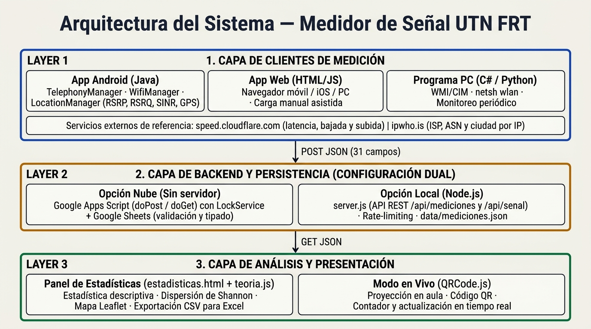

# UNIVERSIDAD TECNOLÓGICA NACIONAL
## Facultad Regional Tucumán
### Ingeniería en Sistemas de Información · Cátedra: Comunicación de Datos

---

# PROYECTO FINAL
# Medidor de Señal UTN FRT

**Sistema multiplataforma de medición, telemetría y análisis estadístico de la calidad de conexiones móviles, WiFi y cableadas, contrastado con la teoría de las comunicaciones**

---

**Integrantes:**
- Bringas, Gonzalo Matías — Legajo 50656
- Guardia Molina, Benjamín — Legajo 48246

**Comisión:** 3K4  
**Lugar y fecha:** San Miguel de Tucumán, noviembre de 2026

---

## Índice

1. [Introducción](#1-introducción)
2. [Problema a solucionar](#2-problema-a-solucionar)
3. [Planteo de la solución](#3-planteo-de-la-solución)
   - 3.1 [Objetivos del sistema](#31-objetivos-del-sistema)
   - 3.2 [Fundamento teórico integrado](#32-fundamento-téorico-integrado)
4. [Explicación del funcionamiento de la aplicación](#4-explicación-del-funcionamiento-de-la-aplicación)
   - 4.1 [Protocolo estándar de medición](#41-protocolo-estándar-de-medición)
   - 4.2 [Cliente Web (`index.html`)](#42-cliente-web-indexhtml)
   - 4.3 [Aplicación Nativa Android (`MedidorSenal-UTN.apk`)](#43-aplicación-nativa-android-medidorsenal-utnapk)
   - 4.4 [Clientes para PC Windows (`MedidorSenal-UTN.exe` y `medidor_pc.py`)](#44-clientes-para-pc-windows-medidorsenal-utnexe-y-medidor_pcpy)
   - 4.5 [Panel de Estadísticas y Modo en Vivo (`estadisticas.html`)](#45-panel-de-estadísticas-y-modo-en-vivo-estadisticashtml)
5. [Arquitectura del sistema](#5-arquitectura-del-sistema)
   - 5.1 [Visión general en tres capas](#51-visión-general-en-tres-capas)
   - 5.2 [Backend dual: nube sin servidor y servidor local](#52-backend-dual-nube-sin-servidor-y-servidor-local)
   - 5.3 [Modelo de datos (31 variables)](#53-modelo-de-datos-31-variables)
6. [Límites del sistema](#6-límites-del-sistema)
   - 6.1 [Limitaciones de plataforma y sistema operativo](#61-limitaciones-de-plataforma-y-sistema-operativo)
   - 6.2 [Limitaciones metodológicas y de muestreo](#62-limitaciones-metodológicas-y-de-muestreo)
   - 6.3 [Limitaciones físicas del modelo teórico](#63-limitaciones-físicas-del-modelo-teórico)
7. [Fuentes de fórmulas y teoría](#7-fuentes-de-fórmulas-y-teoría)
   - 7.1 [Material de la cátedra (`fuentes_teoria/`)](#71-material-de-la-cátedra-fuentes_teoria)
   - 7.2 [Documentos previos del proyecto](#72-documentos-previos-del-proyecto)
   - 7.3 [Bibliografía y estándares de referencia](#73-bibliografía-y-estándares-de-referencia)
8. [Conclusión](#8-conclusión)

---

## 1. Introducción

En la vida académica y cotidiana actual, prácticamente todas las actividades de un estudiante universitario dependen de la conectividad a Internet: el acceso a plataformas institucionales, las clases virtuales, la descarga de bibliografía y el trabajo colaborativo. Sin embargo, la experiencia de navegación varía de manera notable según la operadora móvil (Personal, Claro, Movistar), la tecnología de acceso (4G LTE, 5G NR, WiFi o Ethernet), el entorno físico (interiores con atenuación por muros frente a exteriores) y la congestión horaria.

Habitualmente, estas diferencias se expresan de forma subjetiva (*"en este aula no hay señal"*, *"con esta empresa anda más lento"*), sin contar con mediciones sistemáticas que permitan cuantificar el fenómeno ni vincularlo con los principios físicos que gobiernan la transmisión de datos.

El presente proyecto final, **Medidor de Señal UTN FRT**, resuelve esa brecha mediante el desarrollo de un sistema completo de medición, telemetría colaborativa y análisis estadístico. Su rasgo distintivo es que **cada prueba de red se contrasta automáticamente con los modelos matemáticos estudiados en la cátedra de Comunicación de Datos**: conversión de potencia recibida en dBm a escala lineal, cálculo del piso de ruido térmico de Johnson-Nyquist, estimación y lectura directa de la relación señal/ruido ($\text{SNR}$ y $\text{SINR}$), determinación del límite teórico de capacidad del canal de Claude Shannon y comparación frente a los máximos teóricos por generación tecnológica.

---

## 2. Problema a solucionar

El desarrollo del proyecto parte de tres problemáticas concretas observadas en el ámbito de la cátedra y en el relevamiento de redes locales:

1. **Desconexión entre la teoría de las comunicaciones y la experiencia empírica:** Conceptos centrales como el decibel, la sensibilidad del receptor, el ruido térmico ($N = k \cdot T \cdot B$), la tasa de error de bit (BER) y la capacidad de Shannon ($C = B \cdot \log_2(1 + S/N)$) suelen abordarse únicamente mediante ejercicios numéricos ideales, sin una herramienta accesible que permita observarlos sobre redes reales en funcionamiento.
2. **Limitación de los medidores de velocidad comerciales:** Aplicaciones populares como *Speedtest* o *Fast.com* informan únicamente métricas de capa de aplicación (velocidad de bajada, subida y ping), pero ocultan la física del enlace: no muestran la potencia de señal recibida en dBm, no corrigen el RSRP de una subportadora LTE al ancho de banda total del canal, no calculan el piso de ruido térmico ni explican qué porcentaje del límite teórico de Shannon se está aprovechando.
3. **Falta de una base de datos colaborativa y heterogénea en el curso:** Para analizar estadísticamente el comportamiento real de las redes en San Miguel de Tucumán y en la Facultad Regional Tucumán, se requería un sistema capaz de recolectar muestras desde distintos dispositivos (celulares Android, iPhone y computadoras con Windows) de forma rápida, unificada y proyectable en vivo durante las clases.

---

## 3. Planteo de la solución

Para dar respuesta al problema planteado, se diseñó e implementó un **ecosistema multiplataforma de telemetría y análisis teórico**, compuesto por clientes de medición específicos para cada dispositivo, un almacenamiento centralizado compartible en tiempo real y un tablero analítico con motor de cálculo físico integrado.

### 3.1 Objetivos del sistema

- **Medir con un protocolo reproducible:** Cuantificar velocidad de bajada (Mbps), velocidad de subida (Mbps), latencia mediana (ms) y jitter (ms) contra un mismo servidor de referencia.
- **Capturar telemetría física de red y equipo:** Detectar automáticamente tipo de conexión (`WiFi`, `Datos móviles` o `Cable`), tecnología (`2G`, `3G`, `4G`, `5G`, `802.11n/ac/ax`, `Ethernet`), operadora/ISP y ASN, intensidad de señal (`dBm`), `SINR` y ancho de banda de canal (`MHz`).
- **Centralizar y analizar colaborativamente:** Reunir todas las mediciones bajo un esquema único de 31 campos y calcular estadísticas descriptivas (media, mediana, desvío estándar muestral, mínimo, máximo y correlación lineal de Pearson) junto con gráficos de dispersión y cartografía georreferenciada.
- **Habilitar el uso en aula (Modo en Vivo):** Permitir que el docente proyecte un código QR para que los estudiantes midan desde sus propios dispositivos y vean reflejados los resultados en tiempo real.

### 3.2 Fundamento teórico integrado

El núcleo matemático del sistema reside en el módulo unificado `teoria.js` (y sus réplicas en Java para Android y C#/Python para Windows), que aplica en tiempo real las siguientes ecuaciones de la cátedra:

- **Potencia absoluta en milivatios y submúltiplos (Unidad 3):**
  $$P[\text{mW}] = 10^{\text{dBm}/10}$$
  Convertida automáticamente a la unidad más legible (`mW`, `µW`, `nW`, `pW`, `fW` o `aW`).
- **Piso de ruido térmico de Johnson-Nyquist (Unidad 3):**
  $$N = k \cdot T \cdot B \quad \Longrightarrow \quad N[\text{dBm}] = 10 \cdot \log_{10}\left(\frac{k \cdot (T_{^\circ\text{C}} + 273) \cdot B_{\text{MHz}} \cdot 10^6}{10^{-3}}\right)$$
  donde $k = 1{,}38 \times 10^{-23}\text{ J/K}$ es la constante de Boltzmann. Para $B = 20\text{ MHz}$ y $T = 25\,^\circ\text{C}$, resulta $N = -100{,}8\text{ dBm}$.
- **Corrección de RSRP a potencia total de portadora en 4G/5G (Unidades 2, 3 y 7):**
  En redes celulares LTE/NR con multiplexación OFDM, el módem informa el **RSRP**, que corresponde a una sola subportadora de $15\text{ kHz}$. Dado que un canal de $B\text{ MHz}$ contiene $5 \cdot B$ bloques de recursos de $12$ subportadoras cada uno ($N_{\text{sub}} = 12 \cdot 5 \cdot B$), la potencia total del canal se obtiene sumando en escala logarítmica:
  $$S[\text{dBm}] = \text{RSRP}[\text{dBm}] + 10 \cdot \log_{10}(12 \cdot 5 \cdot B_{\text{MHz}})$$
  En WiFi, en cambio, el **RSSI** ya representa la potencia total del canal.
- **Relación señal a ruido (Unidad 3):**
  $$\text{SNR}[\text{dB}] = S[\text{dBm}] - N[\text{dBm}]$$
- **Capacidad del canal de Shannon-Hartley y aprovechamiento (Unidad 5):**
  $$C = B \cdot \log_2\left(1 + \frac{S}{N}\right), \quad \text{con } \frac{S}{N} = 10^{\text{SNR}[\text{dB}]/10}$$
  El porcentaje de aprovechamiento relaciona la velocidad real medida con el límite teórico $C$, evidenciando las pérdidas por interferencia cocanal, redundancia de control de errores (ARQ/FEC, Unidad 6), encabezados de protocolo y congestión.
- **Canales guiados por cable Ethernet 1000BASE-T (Unidades 5 y 7):**
  Para conexiones cableadas (`Cable`), el sistema aplica el Teorema de Nyquist $C_{\text{Nyquist}} = 2 \cdot B \cdot \log_2(M)$ con $B = 250\text{ MHz}$ (4 pares de $62{,}5\text{ MHz}$) y modulación multinivel 4D-PAM5 ($M = 5$ niveles), junto con el Teorema de Shannon y el despeje inverso de la SNR mínima requerida para sostener el caudal medido:
  $$\text{SNR}_{\min} = 2^{R/B} - 1$$
- **Rangos de calidad y máximos por generación (Unidades 3 y 7):**
  Clasificación de señal para WiFi (sensibilidad de referencia $-82\text{ dBm}$) y 4G RSRP, y contraste frente a los topes teóricos de 2G EDGE ($473{,}6\text{ Kbps}$), 3G HSPA+ ($42\text{ Mbps}$), 4G LTE ($100\text{ Mbps}$ a $1\text{ Gbps}$) y 5G NR (varios Gbps).

---

## 4. Explicación del funcionamiento de la aplicación

### 4.1 Protocolo estándar de medición

Todos los clientes (Web, Android y PC) ejecutan un procedimiento estandarizado para garantizar que las muestras sean comparables entre sí:

1. **Lectura del entorno y red:** Se identifican marca, modelo, sistema operativo, tipo de conexión, tecnología y proveedor de Internet (ISP y ASN mediante consulta a `ipwho.is/`).
2. **Medición de latencia y jitter:** Se realizan 11 peticiones HTTP livianas contra `speed.cloudflare.com/__down?bytes=0`. Se descarta la primera (que incluye la negociación TCP/TLS) y se calcula la **mediana** de las 10 restantes como latencia, y el promedio de las diferencias absolutas consecutivas como **jitter**.
3. **Medición de velocidad de bajada:** Se descargan bloques de tamaño creciente (`0,2 MB`, `2 MB`, `10 MB` y `25 MB`). Si una transferencia supera los `2,5 segundos`, la serie se detiene para evitar un consumo excesivo de datos móviles. Se descarta el primer bloque de calentamiento y se toma el mejor caudal sostenido en Mbps.
4. **Medición de velocidad de subida:** Se envían cargas útiles crecientes (`0,2 MB`, `1 MB`, `4 MB` y `10 MB`) con la misma regla de corte de `2,5 segundos` y descarte del primer bloque.
5. **Geolocalización y consentimiento:** Se solicita ubicación por GPS (si el usuario la autoriza) o se asigna la ciudad aproximada por IP. Antes de transmitir, el usuario revisa los datos, elige el entorno (`Interior`, `Exterior` o `En movimiento`), puede agregar un comentario y debe marcar el consentimiento explícito.

### 4.2 Cliente Web (`index.html`)

Es la puerta de entrada universal (funciona en cualquier navegador móvil o de escritorio, incluido iOS/Safari, sin instalación). Presenta una interfaz de instrumentación técnica con:
- **Detección automática** mediante *User-Agent Client Hints*, *Network Information API* y consulta de IP pública.
- **Velocímetro vectorial SVG** con escala logarítmica de `0` a `1000 Mbps`, aguja animada mediante `requestAnimationFrame` y lectura numérica tabular en tiempo real.
- **Diagnóstico RF inmediato (`#diagnosticoRF`):** Apenas finaliza la prueba, muestra la potencia en `dBm` y `pW`/`fW`, el ruido térmico, la `SNR` y el aprovechamiento respecto al límite de Shannon (o el análisis 4D-PAM5 si se seleccionó `Cable`).
- **Soporte de carga manual asistida:** En navegadores o dispositivos iOS que bloquean la lectura de potencia del módem, permite ingresar opcionalmente los `dBm` o la cantidad de barras de señal (`0` a `4`).

### 4.3 Aplicación Nativa Android (`MedidorSenal-UTN.apk`)

Desarrollada en Java (Android SDK API 34) en `MainActivity.java` y `EstadisticasPanel.java`, resuelve la principal restricción de los navegadores móviles al acceder directamente a las APIs oficiales del sistema operativo:
- **`TelephonyManager`:** Lee en tiempo real `CellSignalStrengthLte` y `CellSignalStrengthNr` para obtener **RSRP**, **RSRQ**, **SINR** real del módem, banda/EARFCN y ancho de canal en MHz (`CellIdentityLte`).
- **`WifiManager`:** Lee el **RSSI**, frecuencia de banda (`2,4 GHz` / `5 GHz`), estándar WiFi (`802.11n/ac/ax`) y velocidad de enlace.
- **`LocationManager`:** Obtiene coordenadas GPS precisas junto con su margen de error en metros.
- Incluye además una pestaña nativa de **Estadísticas** y conmutación de tema claro/oscuro (`Tema.java`).

### 4.4 Clientes para PC Windows (`MedidorSenal-UTN.exe` y `medidor_pc.py`)

El sistema ofrece dos variantes nativas para computadoras con Windows:
- **Aplicación de escritorio compilada (`MedidorSenal-UTN.exe`, `MedidorSenalPC.cs`):** Desarrollada en C# (WinForms) manteniendo la misma estética de cuaderno de telemetría. Consulta `Win32_ComputerSystem` para obtener fabricante y modelo, ejecuta `netsh wlan show interfaces` para leer el estado del WiFi (RSSI, porcentaje de señal, estándar radio, banda y canal) e incorpora un **modo de monitoreo periódico** configurable por intervalo en segundos.
- **Script de línea de comandos (`medidor_pc.py`):** Versión en Python 3 sin dependencias externas, orientada a pruebas automatizadas y de laboratorio mediante parámetros como `--repetir N`, `--cada S`, `--lugar` y `--comentario`, guardando además respaldo local en `pc/mediciones_pc.csv`.

### 4.5 Panel de Estadísticas y Modo en Vivo (`estadisticas.html`)

Es el centro de análisis colectivo de la cátedra:
- **Filtros multidimensionales:** Permite segmentar el dataset por empresa, tecnología, tipo de conexión, entorno (`Interior` / `Exterior` / `En movimiento`) y sistema operativo.
- **Medidas estadísticas por grupo:** Calcula cantidad de muestras ($n$), media, mediana, desvío estándar muestral ($s$), mínimo, máximo y **coeficiente de correlación lineal de Pearson ($r$)** entre la intensidad de señal (dBm) y la velocidad de bajada (Mbps).
- **Visualizaciones interactivas (Chart.js):**
  - *Gráfico de dispersión colectiva:* Proyecta cada medición en el plano $(\text{dBm}, \text{Mbps})$ diferenciando WiFi y Datos Móviles frente a la **curva continua de Shannon** (tanto la cota ideal como la curva práctica ajustada por figura de ruido y overhead de protocolo), recalculada dinámicamente al modificar los controles de ancho de banda $B$ (MHz) y temperatura $T$ (°C).
  - *Gráficos comparativos:* Promedio por grupo, histograma de distribución de frecuencias, participación por sistema operativo y marcas de dispositivos.
- **Desglose teórico paso a paso:** Al seleccionar cualquier fila de la tabla de telemetría, reconstruye en 4 pasos pedagógicos el cálculo de potencia, ruido térmico, SNR, capacidad de Shannon y comparación con el máximo teórico de la tecnología.
- **Cartografía georreferenciada (Leaflet + OpenStreetMap):** Ubica las mediciones en el mapa de San Miguel de Tucumán codificadas por color según rango de Mbps (`> 20 Mbps`, `5–20 Mbps`, `< 5 Mbps` y `Cable`).
- **Modo en Vivo (`#vivo`):** Vista optimizada para proyector de aula que genera un código QR con `QRCode.js`, muestra un contador en vivo y actualiza automáticamente la tabla y los gráficos a medida que los estudiantes envían sus pruebas.
- **Exportación y simulación:** Permite descargar los datos filtrados en formato CSV compatible con Excel en español (BOM UTF-8, separador `;` y coma decimal `,`) y generar un lote de 60 muestras simuladas realistas para demostraciones sin conexión.

---

## 5. Arquitectura del sistema

### 5.1 Visión general en tres capas

El sistema sigue una arquitectura modular desacoplada en tres capas:

### 5.2 Backend dual: nube sin servidor y servidor local

El proyecto soporta dos modos de operación configurables desde `config.js` (`SCRIPT_URL`):

- **Backend en la nube (`backend/google-apps-script.gs`):** Implementado como Web App de Google Apps Script sobre una planilla de Google Sheets. Utiliza `LockService.getScriptLock()` para evitar colisiones ante envíos simultáneos en el aula, valida rangos numéricos de todas las magnitudes físicas, fuerza formato de texto en `version_so` (evitando que Google Sheets interprete versiones como `"18.3"` como fechas) y neutraliza prefijos peligrosos (`=`, `+`, `-`, `@`) para prevenir inyección de fórmulas en CSV/Excel.
- **Backend local autónomo (`server.js`):** Servidor HTTP en Node.js puro (sin dependencias externas) que sirve los archivos estáticos y expone la API REST `/api/mediciones` (`GET` y `POST`, incluyendo carga de lotes y limpieza de simulación) con almacenamiento atómico en `data/mediciones.json` y control de tasa por IP (máximo 30 escrituras por minuto). Además, provee el endpoint `/api/senal`, que consulta `netsh wlan show interfaces` en Windows para dotar de lectura WiFi real al cliente web cuando se ejecuta localmente.
- **Modo autónomo/offline:** Si no hay conexión con el backend configurado, el frontend opera con la semilla inicial de mediciones reales (`window.SEMILLA_INICIAL` en `config.js`) y almacenamiento local en el navegador (`localStorage`).

### 5.3 Modelo de datos (31 variables)

Cada medición se estructura en un registro homogéneo de **31 campos** (`window.CAMPOS`):

| Categoría | Campos registrados |
| :--- | :--- |
| **Identificación y tiempo** | `id` (UUID), `fecha` (ISO 8601 UTC), `origen` (`web`, `android`, `pc`) |
| **Dispositivo** | `tipo_dispositivo`, `nombre_dispositivo`, `marca`, `modelo`, `so`, `version_so`, `navegador` |
| **Red y operadora** | `conexion`, `tecnologia`, `tipo_red_detectado`, `empresa`, `isp_detectado`, `asn` |
| **Rendimiento** | `bajada_mbps`, `subida_mbps`, `latencia_ms`, `jitter_ms` |
| **Capa física RF** | `senal_dbm`, `barras`, `sinr_db`, `ancho_mhz` |
| **Contexto y ubicación** | `lugar`, `lat`, `lon`, `precision_m`, `ubicacion_fuente`, `ciudad`, `comentario` |

---

## 6. Límites del sistema

Un aspecto fundamental de la ingeniería es reconocer con precisión las fronteras técnicas, metodológicas y físicas del sistema desarrollado:

### 6.1 Limitaciones de plataforma y sistema operativo

| Limitación | Causa técnica | Mitigación implementada |
| :--- | :--- | :--- |
| **La versión web no lee `dBm` ni `SINR` del módem** | Por políticas de seguridad y privacidad, los navegadores (Chrome, Safari, Firefox) no exponen APIs de radiofrecuencia ni de capa física celular/WiFi. | Campo opcional de carga manual; lectura nativa automática en la App Android (`MedidorSenal-UTN.apk`) y en los clientes PC (`netsh`). |
| **Restricción absoluta en iOS (iPhone/iPad)** | Apple restringe el acceso a RSRP, RSRQ, RSSI y celda incluso para aplicaciones nativas de terceros. | En iOS se utiliza la versión web registrando tecnología, operadora y barras de señal manualmente. |
| **Nombre del dispositivo oculto en la web** | Los navegadores omiten el hostname del equipo por privacidad (*fingerprinting*). | Campo opcional ingresado por el usuario; detección automática en Android (`Build.MODEL`) y PC (`socket.gethostname()` / WMI). |
| **Ancho de canal `B` no siempre expuesto** | Algunos módems Android antiguos o conexiones web/PC no informan el ancho de banda real de la portadora en MHz. | Se adopta un valor por defecto parametrizable en la interfaz (`20 MHz` para WiFi/4G, `250 MHz` para Ethernet 1000BASE-T). |

### 6.2 Limitaciones metodológicas y de muestreo

- **Dependencia del servidor de prueba:** Las métricas de caudal, latencia y jitter reflejan el trayecto hasta el nodo CDN más cercano de `speed.cloudflare.com`, y no necesariamente el desempeño hacia servidores específicos locales o universitarios. Se mitiga utilizando exactamente el mismo servidor y método en todos los clientes para asegurar comparabilidad relativa.
- **Muestreo no probabilístico:** Los datos recolectados por estudiantes y docentes constituyen una muestra por conveniencia (voluntaria), por lo que las estadísticas representan los puntos, horarios y dispositivos relevados (principalmente en el Gran San Miguel de Tucumán) y no conforman un censo probabilístico de cobertura provincial.
- **Alcance excluido:** El sistema no compara precios ni planes comerciales de las operadoras, no realiza inspección profunda de paquetes (DPI) ni almacena contenido del tráfico, y no se distribuye en tiendas oficiales (Google Play / App Store), sino mediante GitHub Pages y archivo APK firmado/compilado para uso académico.

### 6.3 Limitaciones físicas del modelo teórico

- **Ruido térmico ideal vs. entorno real:** El cálculo $N = k \cdot T \cdot B$ modela únicamente el piso de ruido térmico blanco del receptor. En redes reales operan además la **figura de ruido propia del hardware (NF)**, la **interferencia cocanal y de celdas vecinas** (capturada parcialmente cuando Android reporta la `SINR` real), el **desvanecimiento por multitrayecto** y la **congestión de usuarios** en la radiobase.
- **Brecha frente al límite de Shannon:** La capacidad $C = B \cdot \log_2(1 + S/N)$ es una cota superior teórica asintótica. Ninguna red comercial alcanza el 100 % de $C$ debido a las tramas de señalización, encabezados TCP/IP/MAC, intervalos de guarda OFDM, códigos correctores de errores (FEC) y retransmisiones (ARQ). Por esta razón, el gráfico de dispersión incluye tanto la cota ideal como una curva práctica de referencia ajustada.

---

## 7. Fuentes de fórmulas y teoría

Todas las ecuaciones, definiciones y tablas de referencia implementadas en el sistema provienen directamente del material bibliográfico y los apuntes de la cátedra alojados en la carpeta `fuentes_teoria/` del repositorio.

### 7.1 Material de la cátedra (`fuentes_teoria/`)

1. **Unidad 1 — Sistemas de Comunicación** (`fuentes_teoria/Unidad 1 Sistemas de Comunicación-20260414/`):
   - *Documentos:* `Unidad 1 Sistemas de Comunicacion_2026.pdf`, `1.1_Introduccion.pdf`, `1.2_Capa física del modelo OSI.pdf`, `1.5_Medios de Transmision Guiados y No guiados.pdf`.
   - *Aporte al proyecto:* Modelo básico de un sistema de comunicaciones (fuente, transmisor, canal, receptor, destino y ruido); clasificación de medios guiados (par trenzado UTP) y no guiados (microondas/radiofrecuencia); características de efectividad (entrega, exactitud, puntualidad y jitter).
2. **Unidad 2 — Análisis de las Señales** (`fuentes_teoria/Unidad 2 Analisis de las Señales-20260422/`):
   - *Documentos:* `UNIDAD 2 Analisis de Señales_2026.pdf`, `2.1-Señales y Espectros.pdf`, `2.2-Señales y Espectros.pdf`.
   - *Aporte al proyecto:* Concepto de espectro de frecuencias, dominio del tiempo y frecuencia, y definición de ancho de banda ($B$) como recurso limitado dividido en canales discretos (`5`, `10`, `15`, `20 MHz` en LTE; `20`, `40`, `80`, `160 MHz` en WiFi).
3. **Unidad 3 — Atenuación, Distorsión y Ruido** (`fuentes_teoria/Unidad 3 Atenuacion, Distonsion y Ruido/`):
   - *Documentos:* `UNIDAD 3 Atenuación, Distorsión y Ruido_2026.pdf`, `3.1.-Teoría sobre el ruido e interferencias.pdf`, `3.2.-Deterioro de una senal transmitida.pdf`, `3.3.-Ruido y distorsion.pdf`, `3.4.-Ruido.pdf`.
   - *Fórmulas y teoría extraídas:*
     - Definición de decibel ($\text{dB} = 10 \cdot \log_{10}(P_2/P_1)$) y potencia absoluta en dBm ($P[\text{dBm}] = 10 \cdot \log_{10}(P / 1\text{ mW}) \Leftrightarrow P[\text{mW}] = 10^{\text{dBm}/10}$).
     - Concepto de RSSI, sensibilidad típica de recepción en WiFi $2{,}4\text{ GHz}$ ($-82\text{ dBm}$) y margen de enlace.
     - Atenuación en el espacio libre ($L_0[\text{dB}] = 32{,}45 + 20\log_{10} d[\text{km}] + 20\log_{10} f[\text{MHz}]$).
     - Densidad espectral de ruido térmico ($N_0 = k \cdot T$) y potencia total de ruido térmico ($N = k \cdot T \cdot B$, con $k = 1{,}38 \times 10^{-23}\text{ J/K}$), validado con el **Ejemplo 09** de la guía ($B = 20\text{ MHz}$, $T = 25\,^\circ\text{C} \Rightarrow N = -100{,}8\text{ dBm}$).
     - Relación señal a ruido ($\text{SNR}[\text{dB}] = S[\text{dBm}] - N[\text{dBm}]$) y factor/índice de ruido ($F$, $\text{NF}_{\text{dB}}$).
4. **Unidad 4 — Teoría de la Información y Codificación** (`fuentes_teoria/Unidad 4 Teoría de la Información y Codificación/`):
   - *Documentos:* `Unidad 4 Teoría de la Información y Codificación.pdf`, `4-1_Principios de Transmision de Informacion..pdf` a `4-5.-Teoría de la Informacion.pdf`.
   - *Aporte al proyecto:* Definición de información y entropía de fuente ($H = \sum p_i \log_2(1/p_i)$), tasa de transferencia de información en bits por segundo (bps) y diferenciación entre megabytes (MB) de archivo y megabits por segundo (Mbps).
5. **Unidad 5 — Canales de Comunicaciones** (`fuentes_teoria/Unidad 5 Canales de Comunicaciones-20260702/`):
   - *Documentos:* `Unidad 5 Canales de Comunicaciones.pdf`, `5.1.- CAPACIDAD_DEL_CANAL.pdf`, `5.2.- El teorema de muestreo de Nyquist-Shannon.pdf`, `5.3.- Capacidad del canal 1.pdf`, `5.4-Teoria de la Codificacion de un Canal.pdf`.
   - *Fórmulas y teoría extraídas:*
     - Teorema de Nyquist para canales sin ruido ($C = 2 \cdot B \cdot \log_2 M$).
     - Teorema de Shannon para canales con ruido ($C = B \cdot \log_2(1 + S/N)$), validado con el **Ejemplo 13** de la guía ($B = 20\text{ MHz}$, $\text{SNR} = 20\text{ dB} \Rightarrow C = 133{,}16\text{ Mbps}$; y despeje inverso de SNR requerida).
     - Relación de Shannon-Hartley ($M = \sqrt{1 + S/N}$) y eficiencia espectral ($E_{\max} = C/B\ [\text{bps/Hz}]$).
6. **Unidad 6 — Errores en la transmisión de datos** (`fuentes_teoria/Unidad 6 Errores en la transmisión de datos/`):
   - *Documentos:* `Unidad 6 Errores en la transmisión de datos 2026.pdf`, `6.1. Control de errores.pdf` a `6.5. Codificacion del Canal.pdf`.
   - *Aporte al proyecto:* Tasa de error de bit (BER), estrategias de control de errores (ARQ por retransmisión y FEC mediante códigos redundantes como Hamming) y su impacto directo en la reducción del *throughput* efectivo respecto al límite de Shannon.
7. **Unidad 7 — Técnicas de transmisión de la información** (`fuentes_teoria/Unidad 7 Técnicas de transmisión de la información/`):
   - *Documentos:* `7.0.-Unidad 7 Técnicas de transmisión de la información_2026.pdf`, `7.2.-Transmision_digital.pdf`, `7.3.-Codificacion Banda Base.pdf`, `7.5.-Multiplexacion.pdf`.
   - *Fórmulas y teoría extraídas:*
     - Tabla de ancho de banda digital para servicios WAN inalámbricos (GPRS $171\text{ Kbps}$, EDGE $473{,}6\text{ Kbps}$, UMTS $2\text{ Mbps}$, HSPA+ $42\text{ Mbps}$, LTE $100\text{ Mbps}$ a $1\text{ Gbps}$, 5G NR varios Gbps).
     - Distinción entre tasa de bits ($R$ en bps) y tasa de símbolos/modulación ($r$ en baudios), codificación multinivel `4D-PAM5` en Ethernet Gigabit (`1000BASE-T`) y multiplexación OFDM por subportadoras.

### 7.2 Documentos previos del proyecto

- `fuentes_teoria/TFI/Medidor de Señal/Preproyecto Medidor de Señal - Bringas - Guardia Molina - 3K4.pdf`: Guía de participación y divulgación para la campaña de mediciones del curso.
- `fuentes_teoria/TFI/Medidor de Señal/Proyecto Medidor de Señal - Bringas - Guardia Molina - 3K4.pdf`: Documento de anteproyecto y metodología inicial (octubre de 2026), sobre el cual se amplió el sistema final incorporando soporte para enlaces guiados Ethernet (`1000BASE-T`), servidor local autónomo (`server.js`), aplicación de escritorio compilada (`MedidorSenal-UTN.exe`) y mejoras de visualización e instrumentación RF.

### 7.3 Bibliografía y estándares de referencia

- **Shannon, C. E. (1948).** *A Mathematical Theory of Communication*. Bell System Technical Journal, 27, 379–423 y 623–656.
- **Stallings, W.** *Comunicaciones y Redes de Computadores*. Pearson.
- **Tanenbaum, A. S. y Wetherall, D.** *Redes de Computadoras*. Pearson.
- **Forouzan, B. A.** *Transmisión de Datos y Redes de Comunicaciones*. McGraw-Hill.
- **3GPP TS 36.214.** *Evolved Universal Terrestrial Radio Access (E-UTRA); Physical layer measurements* (definición formal de RSRP y RSRQ).
- **IEEE 802.11 / IEEE 802.3ab.** Estándares de capa física y control de acceso al medio para redes WLAN (WiFi) y Ethernet Gigabit sobre par trenzado (`1000BASE-T`).
- **Android Developers.** Documentación oficial de `TelephonyManager`, `CellSignalStrengthLte`, `CellSignalStrengthNr` y `WifiManager`.

---

## 8. Conclusión

El desarrollo del **Medidor de Señal UTN FRT** demuestra que es posible construir una herramienta de ingeniería de telecomunicaciones accesible, multiplataforma y de despliegue inmediato sin sacrificar el rigor físico ni matemático. Al integrar clientes nativos (Android y Windows) con una aplicación web universal y un tablero estadístico en vivo, el sistema logra recolectar telemetría real de usuarios heterogéneos y transformarla instantáneamente en aprendizaje aplicado.

El contraste empírico entre la velocidad medida y el límite teórico de Shannon-Hartley permite evidenciar en el aula por qué una conexión real siempre opera por debajo de su cota ideal: la presencia de interferencia cocanal (reflejada en la diferencia entre SNR térmica y SINR real del módem), la atenuación por distancia y obstáculos, la sobrecarga de protocolos, el control de errores y la congestión compartida de la celda. De este modo, el proyecto cumple tanto su objetivo técnico —centralizar y analizar la calidad de las redes en el entorno de la UTN FRT— como su objetivo pedagógico, convirtiendo las ecuaciones de la cátedra de Comunicación de Datos en instrumentos vivos e interactivos.
